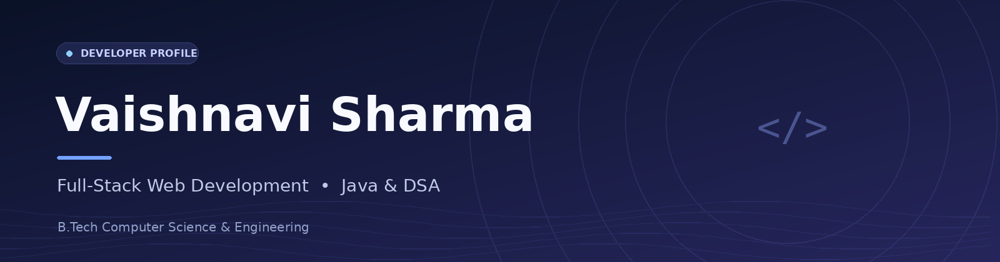

**B.Tech CSE Undergraduate · MERN Stack · Java & DSA · GATE Aspirant**

[GitHub Profile](https://github.com/vaishnavi020402) &nbsp;·&nbsp; [Email](mailto:drishuu22@gmail.com)

## About Me

Hi, I'm **Vaishnavi Sharma**, a Computer Science & Engineering undergraduate at **AKS University, Satna**. I'm interested in building responsive, practical full-stack applications and strengthening my problem-solving skills through **Java and Data Structures & Algorithms**.

- Working with **React, Next.js, Node.js, Express, MongoDB**, and real-time features using **Socket.IO**
- Experienced with **JWT authentication, REST APIs**, and cloud deployment
- Currently preparing for **GATE** and exploring software engineering concepts
- Interested in thoughtful user experiences, dependable backend systems, and collaborative development

## Tech Stack

**Java · JavaScript · TypeScript · React · Next.js · Tailwind CSS · Node.js · Express · MongoDB · Git**

| Area | Technologies |
|:--|:--|
| **Languages** | Java, JavaScript, TypeScript, HTML, CSS |
| **Frontend** | React.js, Next.js, Tailwind CSS, Framer Motion |
| **Backend** | Node.js, Express.js, REST APIs |
| **Database** | MongoDB, Mongoose |
| **Real-time & Authentication** | Socket.IO, JWT |
| **Deployment & Tools** | Firebase, Netlify, Render, Railway, MongoDB Atlas, Git, GitHub |
| **CS Fundamentals** | DSA, OOP, DBMS |

## Selected Projects

### Picksy - Beauty E-commerce Platform

**Next.js · TypeScript · Node.js · MongoDB · Socket.IO · JWT**

A full-stack e-commerce project supporting buyer and seller workflows.

- Contributed to product catalog, cart, and checkout functionality.
- Implemented real-time inventory updates and multi-tab authentication synchronization with Socket.IO.
- Built responsive, mobile-first interfaces with Tailwind CSS.
- Project deployment stack: **Netlify, Railway, and MongoDB Atlas**.

### PHARMILY - Healthcare Management System

**React · Node.js · Express · MongoDB · Socket.IO · JWT**

A healthcare platform designed around patient, doctor, and administrator workflows.

- Developed role-based portals and real-time appointment features.
- Built a geolocation-based emergency SOS workflow for routing alerts to nearby hospitals.
- Added live bed-availability tracking.
- Project deployment stack: **Firebase, Render, and MongoDB Atlas**.

> Project descriptions are based on my resume. Repository and demo links can be added once their exact URLs are confirmed.

## Education & Learning

- **B.Tech in Computer Science & Engineering** - AKS University, Satna
- **Current CGPA:** 8.45 (as listed on my resume)
- **Current focus:** GATE preparation, Java DSA, full-stack development

## Certifications & Participation

- **Skill India Mission (PMKVY)** - Software Developer, NCVET-certified, 420-hour program (2025)
- **AKS University** - Web Development (2024)
- **IBM SkillBuild** - Web Development Completion Certificate
- **Apna College** - Full MERN Stack Training, Sigma Batch 8.0
- **Smart India Hackathon 2025** - Team project focused on a civic-issue-reporting use case

## GitHub Activity

Explore my [repositories and contributions on GitHub](https://github.com/vaishnavi020402?tab=repositories). This link opens GitHub's own activity view and avoids unreliable third-party stat images.

## Let's Connect

I enjoy learning from other developers and collaborating on practical projects.

- **GitHub:** [@vaishnavi020402](https://github.com/vaishnavi020402)
- **Email:** [drishuu22@gmail.com](mailto:drishuu22@gmail.com)

*Learning continuously. Building with purpose.*

